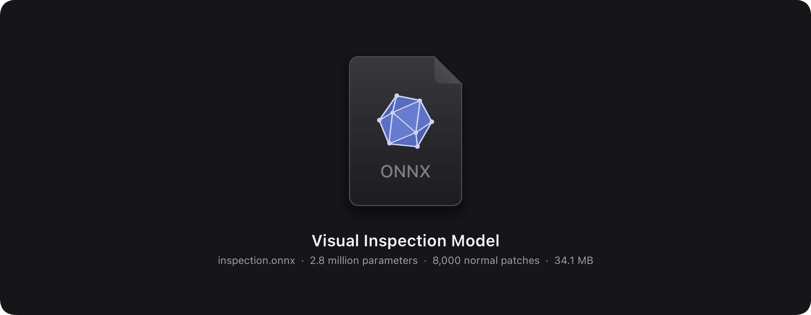
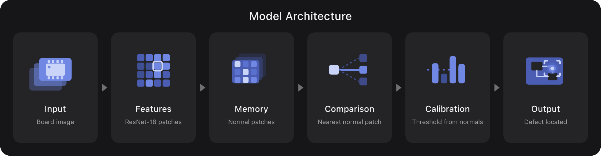
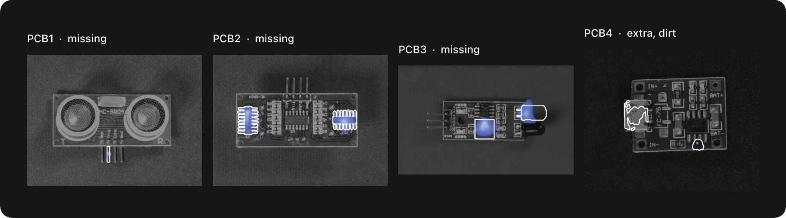
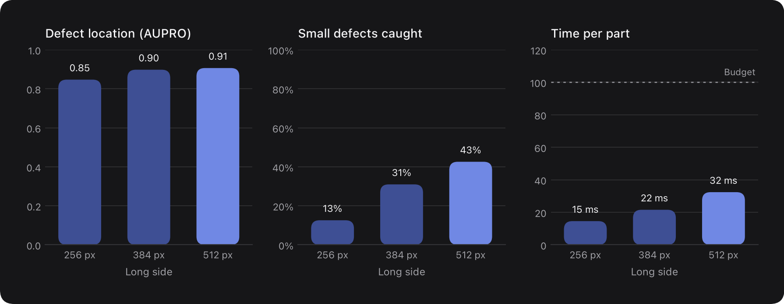
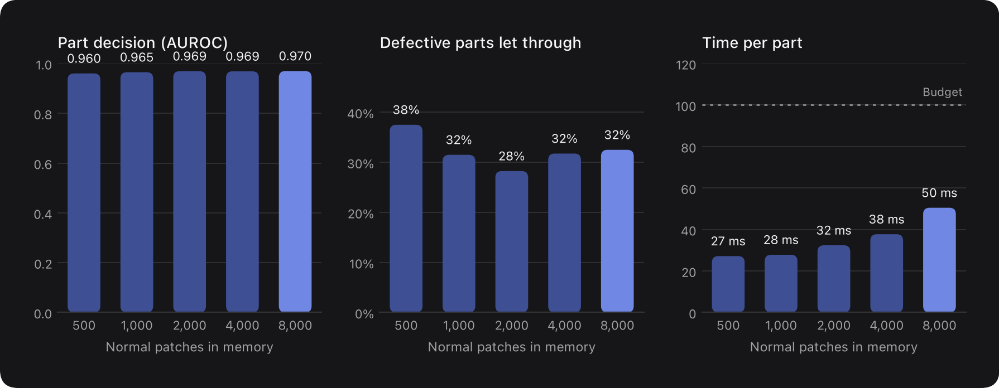
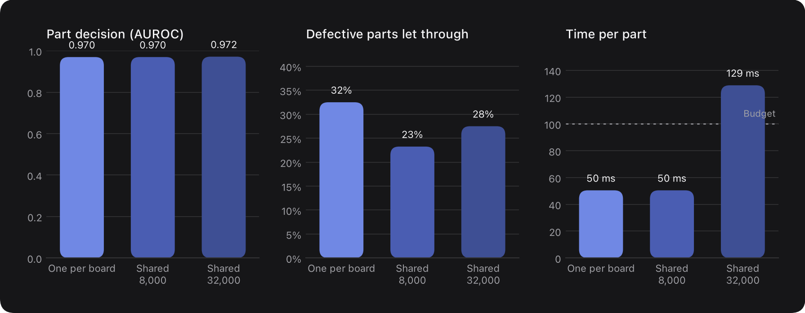

# Visual Inspection



Visual Inspection is a model that decides whether a printed circuit board is defective and shows where the defect is. It learns only from images of good boards, because defect examples are rare on a real line, and it runs on a laptop CPU in 50 ms per board. One model serves four different boards. Its decision threshold is set from good boards alone, with a stated limit on how many good boards it may reject.

## How It Works



**Input.** A colour image of the board, with the long side resized to 512 pixels.

**Features.** A ResNet-18 pretrained on ImageNet reads the image. The model keeps the outputs of its second and third layers, which describe local structure such as a pin, a solder joint or a component edge, and joins them into one 384-value feature for every 8 x 8 pixel patch. Each feature is averaged with its neighbours, so a patch also carries a little of its surroundings. The backbone is never trained.

**Memory.** Patch features from 800 good boards, 200 of each type, are reduced to 8,000 patches by greedy coreset selection. Each step keeps the patch farthest from everything already kept, so rare but normal structures stay in memory while near-duplicates are dropped.

**Comparison.** Each patch of a new board is compared with its nearest patch in memory. A patch unlike anything seen on a good board is far from all of them. These distances form a map that is upsampled to the image and smoothed. The board's score is the map's highest value, because one bad spot is enough to make a bad board.

**Calibration.** The threshold is set from a separate 800 good boards that the memory has never seen. It is the conformal quantile of their scores for a 1% false-reject target, which bounds the share of good boards rejected on average without using a single defect image.

**Output.** A decision for the board, and a defect map showing where it differs from good boards.

## How It Performs

The model is tested on the VisA test split for four boards, PCB1 to PCB4: 401 good boards and 400 defective ones, with defects such as missing or bent components, melted parts, scratches and dirt. No defect image is used to fit the memory, set the threshold or choose any setting. Every setting was fixed by a rule decided before the results were seen.

| Released model | Value |
| :-- | --: |
| Ranking of defective above good boards (AUROC) | 0.970 |
| Good boards rejected | 3.5% |
| Defective boards let through | 23.3% |
| Time per board, 95th percentile | 50 ms |

The ranking is strong, but the operating point shows its cost. Most of the defective boards that get through carry small defects, and the threshold has to sit above every score a good board can reach.

<p>
  
  <br>
  <sub><b>Defect maps.</b> One typical caught defective test board of each type, from per-board memories at the released resolution. The blue regions are where the map is above the board's threshold, and the white outlines are the annotated defects.</sub>
</p>

## Engineering Decisions

### Setting the threshold without defects

The threshold is the conformal quantile of the calibration scores, the 199th smallest of 200 for each board type. The table compares it with the threshold that would give the best F1 if the defects were known in advance, which a real line could not use.

| Board | Good rejected, from good boards | Defective let through, from good boards | Good rejected, with defects | Defective let through, with defects |
| :-- | --: | --: | --: | --: |
| PCB1 | 4% | 19% | 10% | 3% |
| PCB2 | 2% | 34% | 9% | 8% |
| PCB3 | 3% | 30% | 12% | 8% |
| PCB4 | 0% | 47% | 7% | 1% |
| Mean | 2.2% | 32.5% | 9.5% | 5.0% |

Catching almost every defect is possible, but only by rejecting about one good board in ten. With no defect data, the station can only promise its false-reject rate, and the escapes follow from it. The measured rate, 2.2%, is above the 1% target. Each board type has only about 100 good test boards, so one wrongly rejected board moves the rate by a full percent.

### Catching small defects

Most defects cover less than 1% of the board. At low resolution a small defect shrinks to a single patch and blends with its neighbours.

<p>
  
  <br>
  <sub><b>Working resolution.</b> Left, how well the map locates each defect (AUPRO up to a 30% false-positive rate). Centre, the share of defective boards with defects under 0.2% of their area that are rejected. Right, time per board at the 95th percentile on a laptop CPU, against the 100 ms budget. All with a memory of 2,000 patches per board. Going from 256 to 512 pixels raises small-defect catches from 13% to 43% for 17 ms more.</sub>
</p>

At 512 pixels, 43% of small defects, 76% of medium ones and 92% of large ones are caught. Small defects remain the model's main weakness.

### The size of the memory

<p>
  
  <br>
  <sub><b>Memory size.</b> AUROC, the share of defective boards let through, and time per board for memories of 500 to 8,000 patches per board at 512 pixels. Location improves steadily, from an AUPRO of 0.86 to 0.92, while AUROC levels off at about 0.97 from 2,000 patches. The comparison with memory is the part of the model whose cost grows, from 27 ms to 50 ms.</sub>
</p>

The rule picks the highest resolution, then the largest memory, that stays within the 100 ms budget, which gives 512 pixels and 8,000 patches.

### One model or one per board

A shared memory is simpler to run but carries a risk: a defect on one board can look like a normal patch of another board and go unnoticed. Three options were compared at the released resolution. The rule was to share the memory only if its AUROC came within 0.01 of separate memories and it let no more defects through.

<p>
  
  <br>
  <sub><b>Shared or separate memory.</b> One memory of 8,000 patches per board, one shared memory of 8,000 patches, and one shared memory of 32,000 patches. The shared memories use one threshold calibrated on all four board types. The shared 8,000-patch memory matches the separate ones at an AUROC of 0.970 and lets 23% of defects through instead of 33%. The 32,000-patch memory takes 129 ms, over budget.</sub>
</p>

The shared memory was released. Its lower escape rate is partly the effect of a single threshold, which sits lower for some board types. It rejects 3.5% of good boards instead of 2.2%, a cost the release rule did not weigh. One file now serves all four boards, and a new board type is added by adding its good images to the memory.

## How to Use It

The model is released in `models/` as `inspection.onnx` (34.1 MB), and the station code is `src/inspector.py`. Running it needs NumPy, OpenCV and ONNX Runtime. The model card, `models/model.json`, records the data, settings, threshold and results.

### Installation

```bash
git clone https://github.com/iamabdirazak/visual-inspection.git
cd visual-inspection
python3 -m venv .venv && source .venv/bin/activate
pip install numpy scipy opencv-python onnxruntime matplotlib pillow pytest
```

### Inspecting a Board

```python
import cv2
from src.inspector import Inspector

inspect = Inspector("pcb1")
verdict = inspect(cv2.imread("board.jpg"))
verdict.defective          # True or False
verdict.map                # defect map at the image's size
```

### Reproducing the Results

```bash
pip install torch torchvision onnx scikit-learn
mkdir -p data/visa && cd data
URL=https://amazon-visual-anomaly.s3.us-west-2.amazonaws.com/VisA_20220922.tar
curl -L $URL | tar -xf - -C visa --include 'pcb1/*' --include 'pcb2/*' --include 'pcb3/*' --include 'pcb4/*' --include 'split_csv/*'
cd ..
python -m pytest -q
python -m src.evaluation.latency
python -m src.evaluation.run
python -m src.export.release
python -m src.visualization.diagrams
python -m src.visualization.results
```

The archive is streamed once and only the four boards are kept, 928 MB on disk.

## Limitations

- Tested on four board types from one dataset, photographed under controlled light. A real station's lighting and fixtures would need their own calibration set.
- Defects under 0.2% of the board are caught less than half the time at the 1% false-reject target.
- The conformal bound holds on average over calibration sets, and only if new good boards look like the calibration boards.
- Each board type has about 100 good test boards, so false-reject rates are measured in steps of 1%.
- Times are measured on a laptop CPU with ONNX Runtime and four threads, not on station hardware.

## License

The code is released under the MIT License. The backbone weights come from torchvision's ImageNet ResNet-18. [VisA](https://github.com/amazon-science/spot-diff) is provided by Amazon under the CC BY 4.0 license, and its images are not redistributed here.

## Author

Abdirazak Mubarak, November 2026
